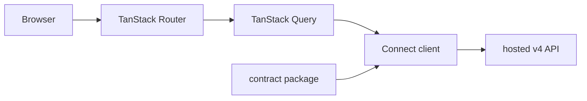

# Architecture

`chill-web` is a client-rendered React app. The browser calls the hosted API
through Connect and imports public types from `@chill-institute/contracts`.

## Ownership

| Path                         | Owns                                                   |
| ---------------------------- | ------------------------------------------------------ |
| `src/routes/`                | File-route shims and route composition                 |
| `src/api/`                   | Connect transport, API helpers, defaults, and timeouts |
| `src/auth/`                  | Tokens, API context, auth routes, coupled controls     |
| `src/catalog/`               | Movie and TV queries, routes, and modals               |
| `src/queries/`, `src/hooks/` | Search and settings queries and hooks                  |
| `src/stremio/`               | Stremio add-on link setup                              |
| `src/lib/`                   | Environment, crash reporting, PWA updates, search data |
| `src/workers/`               | Static-asset Worker; header and redirect tests         |
| `src/ui/`                    | Design tokens, primitives, pure hooks, presentation    |
| `src/components/`            | App shell, search, settings, cross-surface UI          |

`src/ui/` must not import auth or API code. Product behavior stays in the
hosted API; the web repo owns browser state, requests, and rendering.

## Routes

Route files in [`src/routes/`](../src/routes) stay thin; auth route behavior
lives in [`src/auth/route-options/`](../src/auth/route-options). `/auth/*` also
serves the chilly-token page for the CLI, MCP, and scripts.

## Catalog Sort

One `UserSettings.catalog.sort` preference applies across movies, TV, and all
providers, independently of search sorting. Picker changes save to put.io through
the settings mutation. A `sort` search param overrides it for that URL without
changing the saved preference. Sort values, legacy `year-*` aliases, and tie
rules live in [`src/catalog/lib/sort.ts`](../src/catalog/lib/sort.ts) and its
tests.

## Request Path

Routes call TanStack Query hooks, which obtain the API client from auth context.
The transport sends requests to `/v4`, identifies itself as `web`, and includes
the deployment version in `X-Chill-Client-Version`.

Hosted response data is untrusted. Timeouts, auth failures, route recovery,
and errors are explicit UI states.

## Environment

Browser build variables are typed in [`src/env.d.ts`](../src/env.d.ts); API and
Stremio origin defaults live in [`src/lib/env.ts`](../src/lib/env.ts).
[`vite.config.ts`](../vite.config.ts) stamps the version and release and reads
the CI-only `SENTRY_AUTH_TOKEN`, `SENTRY_ORG`, and `SENTRY_PROJECT` for
source-map upload.

Sentry stays off unless the build receives a public DSN and environment. It excludes product analytics,
session replay, default PII, request bodies, query strings, and default browser
breadcrumbs. Known extension noise and recoverable module-load failures are
dropped; terminal failures remain reportable. Filters live in
[`src/lib/sentry.ts`](../src/lib/sentry.ts).

Build and artifact checks are described in [Deployment](./DEPLOYMENT.md).

## Stremio setup

`/stremio` gets private add-on links from the chill API, sending the chill
token only in an Authorization header. Requests, link validation, and error
mapping live in [`src/stremio/api.ts`](../src/stremio/api.ts).

- Each link keeps the download folder it was issued with; later folder changes,
  here or in settings, do not move it.
- A new link appears once, masked, with install, copy, and show actions.
  Clipboard failures reveal and select it for manual copying.
- The link stays in component state only: never in storage, URLs, telemetry,
  public screenshots, or support reports.
- Disconnect asks for confirmation, stops every link for the account, and
  leaves the website and CLI signed in.

Discovery, release selection, downloads to put.io, progress, and playback stay
in Stremio. Credentials and disconnection belong to the chill API; the hosted
adapter belongs to `chill-stremio`. `VITE_PUBLIC_STREMIO_BASE_URL` sets the
adapter origin at build time; it must be HTTPS except localhost in development.

Fixture coverage is `pnpm exec vp exec playwright test e2e/stremio.spec.ts` and
[`e2e/visual/stremio.visual.spec.ts`](../e2e/visual/stremio.visual.spec.ts).
These tests never use real credentials or start provider transfers.
